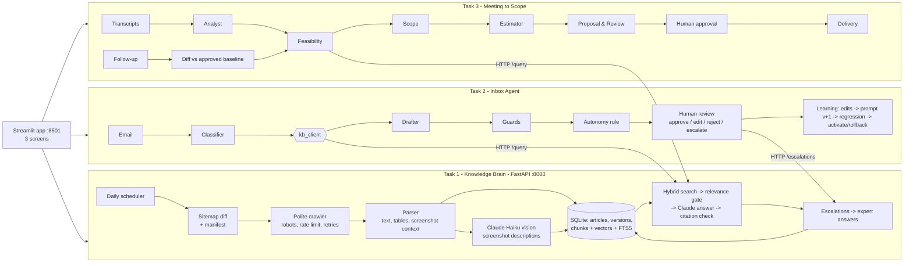

# Design

## 1. The problem, in plain words

A small software agency used to charge $2,000 for a website change. AI coding tools pushed that price toward
$200, so the agency must handle about ten times more clients with the same people. Writing code is now the fast part.
The slow parts are everything around the code:

1. **Knowing the product.** The answer is usually somewhere in hundreds of help articles and screenshots, and those change every week.
2. **Answering email.** Every email means reading, looking things up, writing, and remembering follow-ups.
3. **Turning meetings into quotes.** Clients speak loosely ("make search better"). Someone has to turn that into exact tasks, check what the product already does, estimate the work and catch scope creep.

This project builds one assistant for all three, around a single shared **Knowledge Brain**, so any software
business could plug in its own help center, inbox and meetings.

## 2. Needs we found that the brief did not spell out

| Need we found | What we built |
|---|---|
| An expert's answer to one customer is not always a product fact. | Expert answers are tagged `general` (searchable) or `customer_specific` (stored, never reused), can expire, and are versioned. |
| A fluent answer can still be wrong, and a citation can be fake. | Claude may only cite evidence ids we supplied; answers citing nothing valid are downgraded to "insufficient evidence". |
| Off-topic questions should not cost money. | A calibrated similarity gate abstains before calling Claude (threshold set from measured data, §6). |
| Help articles and customer emails can contain hostile instructions. | Evidence and emails are wrapped as untrusted data, wrapper-closing tags are stripped, and injection phrases are detected and flagged. Tested. |
| Approving a draft is not the same as accepting it unchanged. | Autonomy counts only drafts whose sent text equals the AI text; one click does not count. |
| A customer complaining right after an automatic reply is the clearest quality signal. | It revokes that category's autonomy immediately. |
| LLMs make arithmetic and price mistakes. | The models propose hours only. Totals, contingency and price are computed in code from `pricing.yaml`; a narrative that mentions money is a blocker. |
| A summary can invent what the client said. | Every requirement carries a line-numbered quote, verified against the transcript in code. Unverifiable "confirmed" items are downgraded to "unclear". |
| An unapproved AI suggestion must never become the contract. | Follow-ups are compared with the latest **approved** version, never the latest draft. |
| A settings change is cheaper for the client than custom code. | The feasibility agent checks every requirement against the Knowledge Brain before anything is estimated as custom work. |

## 3. Architecture

**Why one shared Knowledge Brain behind an API.** Product knowledge changes daily. If Tasks 2 and 3 copied it,
they would drift. Behind one API, an article update or an expert answer reaches every consumer immediately,
and another business could swap in its own help center without touching Tasks 2 and 3. Tasks 2 and 3 import only
`common/kb_client.py`, a typed HTTP client, and never Task 1 code. The typed client never returns a made-up
answer: if the service is down it raises `KnowledgeUnavailable`, and both tasks show that state instead of drafting.

## 4. Task 1: Knowledge Brain

- **Polite, resumable crawl.** The sitemap (1,699 URLs, 1,540 articles) is diffed against a SQLite manifest:
  new, changed (by `lastmod`), failed (retry), removed (deactivate). It uses 2 concurrent requests and a 1 s gap,
  respects robots.txt, retries timeouts, 429s and 5xx errors with exponential backoff, and never retries a 403. Each page commits on its own,
  so a crash loses nothing and a re-run continues. Measured full-crawl time: see EVALS.md.
- **Parsing.** Only `article.article-body` is used. Headings, numbered steps and tables are kept, and every screenshot
  keeps its position plus the sentence before it (usually the instruction it illustrates). Tracking pixels and banners are dropped.
- **Screenshots.** Claude Haiku 5.5 describes each screenshot as JSON: description, exact UI labels, steps, and an
  `uncertain` flag. The prompt forbids guessing unreadable labels. Descriptions are searchable chunks linked to
  their article and the original image URL, which the chat screen displays. Haiku costs about 50 times less than Sonnet
  per screenshot, which is what makes describing thousands of screenshots affordable (count and cost in EVALS.md).
- **Storage and search.** SQLite holds everything. Vectors (local `bge-small`, no extra API key) sit in a BLOB column
  and are searched with numpy, and SQLite FTS5 provides BM25 keyword search. At about 15k chunks a dedicated vector database
  adds operations work without measurable benefit. We measured vector, keyword and hybrid search (EVALS.md) and use hybrid.
  Chunk ids are stable hashes, and re-processing replaces an article's chunks, so updates are idempotent.
- **Answering.** Hybrid top-8 retrieval, then a similarity gate (abstain without a model call below 0.65), then Claude with evidence in
  `<evidence id="E1">` tags and a structured output (`status`, `answer`, `cited_evidence`, `confidence`). Citations
  are validated in code.
- **Freshness.** A daily 03:00 UTC job re-reads the sitemap and processes only differences. Each article change creates a
  version row, so `rollback_article()` can restore an earlier version if a parse goes wrong. Deleted pages are
  deactivated and vanish from search immediately (tested).

## 5. Task 2: Inbox Agent

- **Eight fixed categories**: how-to, troubleshooting, project request, refund/cancellation, complaint, quote,
  follow-up, other (spam and phishing). They are fixed so that "the same kind" is stable for the autonomy rule.
- **Pipeline.** Deterministic injection check, then the classifier (category, risk, urgency, flags, a rewritten help-center
  question), then `/query`, then the drafter (structured: reply, requires_human, next action, follow-up days, cited sources),
  then **guards** (regex rules for refund/cancellation claims, prices not in evidence, deadlines, credentials, and links not from
  cited sources), then the autonomy decision. Thread history and the last two human-approved replies of the same kind go into the prompt.
- **Human review** (Inbox screen): send as is, edit and send, reject and replace, or escalate to an expert (creates a Task 1
  escalation). Every interaction stores the email, category, sources, draft, final text, similarity, reviewer,
  reason, model and prompt versions, cost and latency. Sends go to a simulated outbox with an idempotency key, so no double sends.
- **The 20-in-a-row rule.** *Same kind* means the same category. *Unchanged* means the sent text equals the draft after collapsing
  whitespace. Edits, rejections, escalations and guard failures reset the streak. At 20 the category becomes autonomous,
  except money, complaints, quotes, scope requests and "other", which can never auto-send. Even then an email auto-sends only if it is
  low-risk, not urgent, grounded (KB answered) and has no flags or guard hits. **Every 10th** autonomous email is held for audit, and
  an edited audit revokes autonomy. A complaint after an auto-reply also revokes it. There is a global off switch and a manual revoke.
  Everything is written to the audit log.
- **Learning.** Two loops. (1) Fast: approved replies become style examples for the next draft of that kind. (2) Measured:
  `learning.py` asks Claude Sonnet to infer the reviewer's recurring preferences from stored edits, saves them as a new
  drafter prompt version that is **not active**, scores both versions on held-out emails (edit rate, guard violations, cost),
  and activates the new one only if it is better. Rollback is one click (Learning tab) or `set_active`.
  For a repeatable experiment we use a deterministic *simulated reviewer* with five house-style rules. It is clearly
  labelled as a simulation; real UI edits feed the same code.

## 6. Task 3: Meeting to Scope

Five agents, each with one job and a validated Pydantic hand-off. We did not add more, because each extra agent is
another place to lose information.

| Agent | Input → output | Code checks after it |
|---|---|---|
| Transcript Analyst | transcript sections → requirements, decisions, constraints, questions, commitments, exclusions, each with line + quote | quotes verified against the transcript; stable `REQ-001` ids assigned in code |
| Product Feasibility | requirement → Knowledge Brain `/query` → existing setting / existing with limits / custom / needs clarification | "no evidence" can never become "existing", and becomes "custom" only if the need is inherently bespoke |
| Scope | brief + feasibility → deliverables with testable acceptance criteria, exclusions, dependencies, client duties | every requirement in exactly one deliverable |
| Estimator | scope → tasks with low/likely/high hours and assumptions | order fixed, PERT expected hours, contingency and price computed in code |
| Proposal & Review | everything → narrative (no numbers) + senior review findings | money in the narrative is a blocker; tables rendered by code |

**Long transcripts** are split by whole speaker turns with an overlap, extracted per section, merged, then verified.
**Follow-ups**: the analyst extracts the new meeting, a mapper links each item to an approved baseline id (same / modified / new)
plus explicit removals, and **code** builds the change report (added, modified, removed, unchanged, out of scope,
deadline/budget change, hours delta). New items are out of scope until quoted. **Approval**: versions are drafts until a named
reviewer approves; drafts with blockers need a written note; `deliver()` refuses anything not approved. Every attempt is audited.

## 7. Model choices

Claude Haiku 5.5 ($0.10/$0.50 per M tokens) and Claude Sonnet 5.5 ($2/$10) were compared on the same test sets
(EVALS.md). Routing used in the code, configurable via `.env`:

| Job | Model | Why (see EVALS.md for numbers) |
|---|---|---|
| Screenshot descriptions | Haiku | high volume; cost dominates |
| KB answers | _filled in from measured comparison_ | |
| Email classification / drafting | _filled in from measured comparison_ | |
| Scope agents | _filled in from measured comparison_ | |
| Eval judge, prompt learner | Sonnet | fixed, stronger grader; low volume |

## 8. Features we dropped, and why

- **TypeScript for Task 2**: the developer is a beginner in TypeScript, and the brief allows Python. Mixing languages within one task is avoided.
- **Real email sending/IMAP**: risk of sending unreviewed mail; simulated outbox instead, as the guide permits.
- **Dedicated vector DB / reranker model**: SQLite + numpy is fast enough at this size; hybrid search already gives MRR 0.92.
- **Knowledge graph**: help-center structure (category → folder → article) is kept as metadata, and no measured need appeared for more.
- **Calendar booking, SMS, real CRM integrations**: outside the three workflows.
- **Fine-tuning**: versioned prompts + examples give a measurable, reversible improvement loop at far lower cost.

## 9. What breaks (known limits)

- Screenshot descriptions can be wrong. They are labelled as AI-generated, and article text wins when the two disagree.
- The abstention threshold was calibrated on 31 questions; an off-topic question can score 0.715, above it. In that case Claude's own judgement is the second line of defence.
- The simulated reviewer measures learning against known rules; real reviewers are noisier.
- Hour estimates have no historical data to compare against yet. Estimate error needs a human reference estimate (EVALS.md).
- The transcripts used during development are placeholders until the real role-played recordings are added.
- SQLite with one writer suits one team. Many concurrent reviewers would need Postgres.

## 10. What we would build next

Postgres with pgvector, real Gmail/Outlook integration behind the same review gate, a calibrated confidence score,
learning across tasks (accepted proposals informing estimates), and per-client knowledge bases for multi-tenant use.
